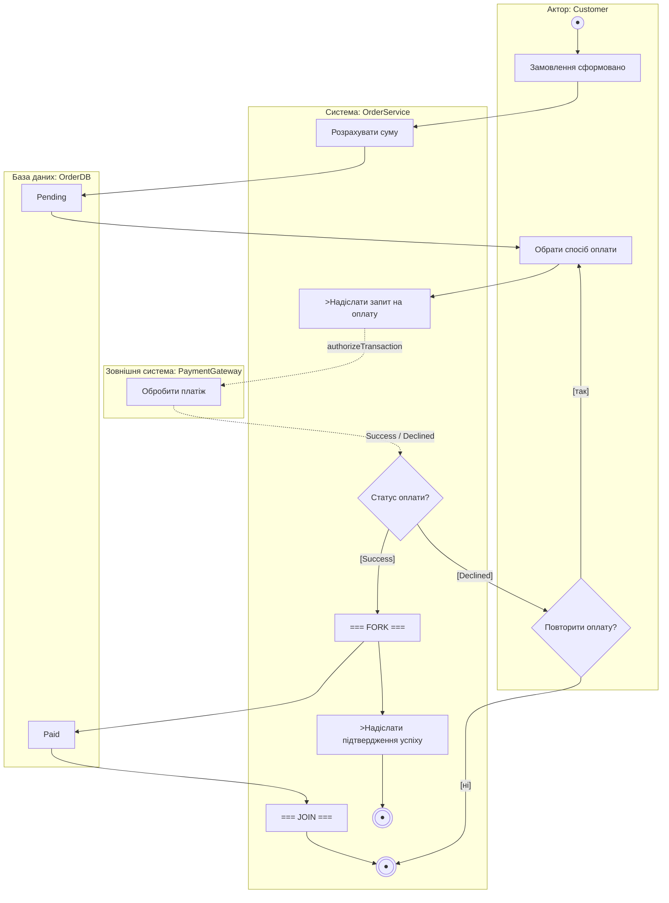

# Prompts and Generations (Lab 4)

## 1: Перша генерація Activity-діаграми бізнес-процесу оплати

### Промпт 1 (на основі файлу spec.md)

> На основі файлу `spec.md` побудуй єдину Activity-діаграму у форматі Mermaid (`flowchart TD` зі swimlanes) для бізнес-процесу оформлення та оплати замовлення (`Checkout Order` + `Calculate Total` + `Process Payment`). Покажи початок і кінець, розгалуження, цикл повторної спроби оплати, паралельну гілку (`fork`/`join`) та обмін повідомленнями з `PaymentGateway`.

### Відповідь ШІ (Версія 1)

## 2: Аудит версії 1 та уточнювальний промпт після оновлення spec.md

### Фідбек до ШІ та Промпт 2 (на основі оновленого spec.md)

> У версії 1 діаграми виявлено 3 критичні порушення правил нотації та оновленого `spec.md`:
> 1. **БД як окремий учасник процесу та стани замість дієслів:** Ти додав окремий swimlane `OrderDB` (що заборонено правилами діаграми діяльності та `spec.md`), а у прямокутниках дій написав стани `"Pending"` і `"Paid"` замість дієслів. Прибери `OrderDB` як доріжку, покажи `Product` та `Order` як вузли даних (`Data Object`), а всі кроки сформулюй дієсловами («Розрахувати загальну суму замовлення», «Змінити статус замовлення на Paid»).
> 2. **Розірваний `fork` без `join`:** Після `fork` гілка надсилання сповіщення клієнту завершилася власним кінцем `End1` замість повернення у вузол синхронізації `join`. Усі гілки `fork` мають сходитися в `join` (`allSettled`) перед завершенням процесу.
> 3. **Пропущено реакцію на відсутність відповіді / таймаут `3.0 с`:** Після надсилання запиту до `PaymentGateway` показано лише `Success` та `Declined`, але повністю пропущено Сценарій 3 із Лаб 2–3 (коли клієнт закриває сторінку шлюзу до завершення або спливає `> 3.0 с` за `NFR-3`, `PaymentGateway` не надсилає підтвердження, а `OrderService` утримує `Order.status = "Pending"` і повідомляє клієнта).
>
> Перегенеруй єдину Activity-діаграму для файлу `process.md` строго за оновленим `spec.md`, додай вузли даних `Product` і `Order`, вичерпні умови у `[ ]` та явні повідомлення між учасниками.
