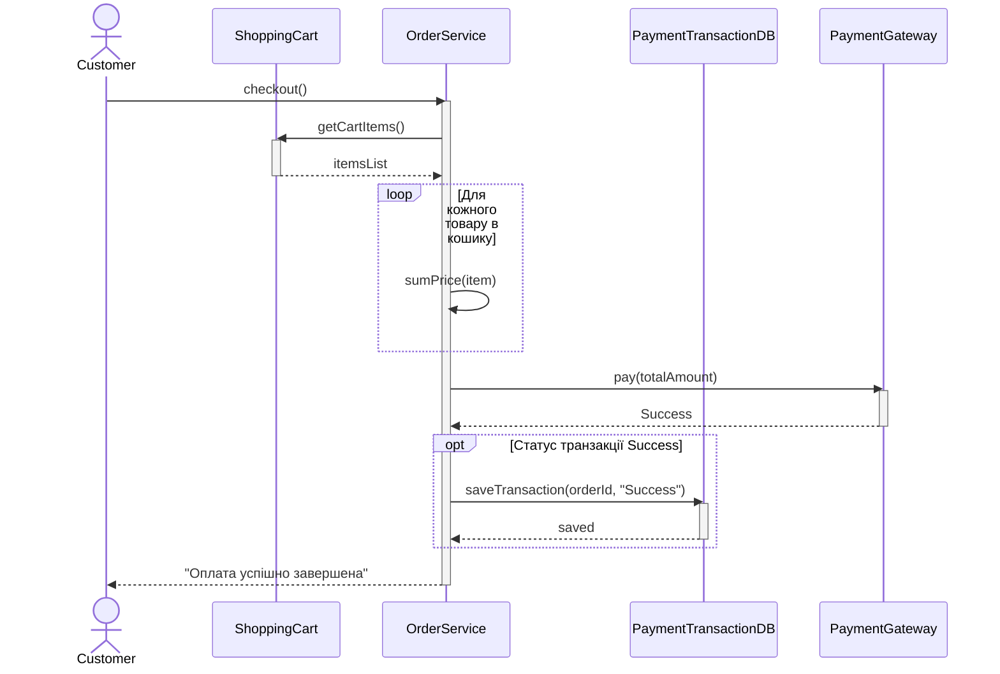
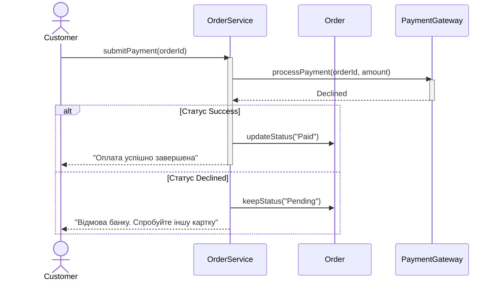
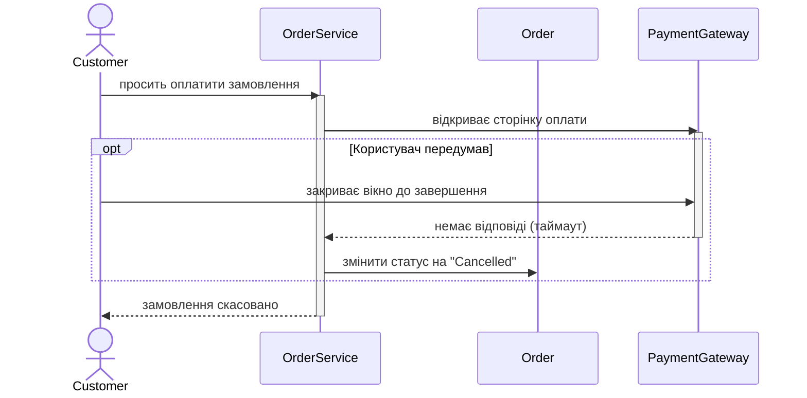

# Prompts and Generations (Lab 3)

## 1: Сценарій 1 — Успішна обробка платежу

### Промпт 1 (на основі файлу spec.md)

> На основі файлу `spec.md` побудуй детальну Sequence-діаграму у форматі Mermaid (`sequenceDiagram`) для Сценарію 1 (Успішна обробка платежу). Покажи взаємодію між учасниками для розрахунку суми замовлення та проведення оплати через платіжний шлюз. Обов'язково використай комбінований фрагмент (`loop` або `opt`) та блоки активації (`activate`/`deactivate`).

### Відповідь ШІ (Версія 1)

## 2: Сценарій 2 (Відмова банку) та Сценарій 3 (Переривання оплати / Таймаут)

### Промпт 2 (на основі файлу spec.md)

> Згенеруй окремі Sequence-діаграми у форматі Mermaid (`sequenceDiagram`) для Сценарію 2 (Неуспішна обробка платежу — статус `Declined`) та Сценарію 3 (Переривання оплати користувачем / Таймаут). У кожній діаграмі використай фрагмент `alt` або `opt` та лінії активації.

### Відповідь ШІ (Версія 1)

**Сценарій 2: Відмова банку**

**Сценарій 3: Переривання оплати користувачем (Таймаут)**

