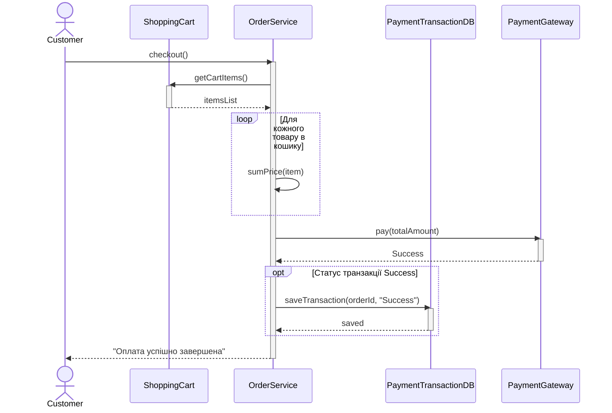

# Prompts and Generations (Lab 3)

## 1: Сценарій 1 — Успішна обробка платежу

### Промпт 1 (на основі файлу spec.md)

> На основі файлу `spec.md` побудуй детальну Sequence-діаграму у форматі Mermaid (`sequenceDiagram`) для Сценарію 1 (Успішна обробка платежу). Покажи взаємодію між учасниками для розрахунку суми замовлення та проведення оплати через платіжний шлюз. Обов'язково використай комбінований фрагмент (`loop` або `opt`) та блоки активації (`activate`/`deactivate`).

### Відповідь ШІ (Версія 1)

