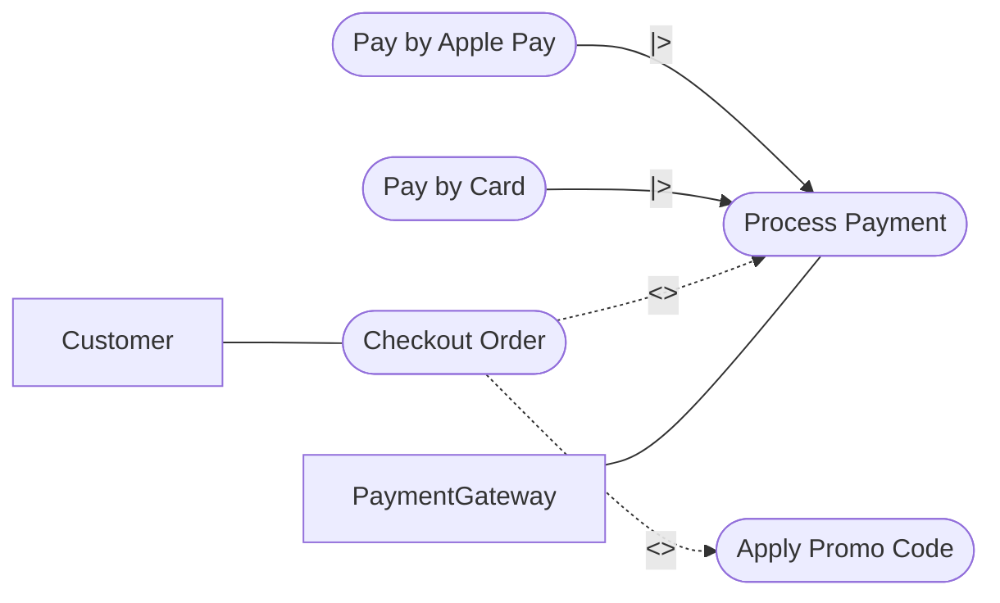

# prompts and generations (Лаб 2)

## 1: EARS-вимоги

### Промпт 1 (із файлу spec.md)

> Згенеруй EARS-вимоги: Мінімум 4 вимоги (шаблони: Ubiquitous, State-driven, Event-driven, Optional). Вимоги мають бути однозначними й тестованими.

### Відповідь ШІ (Версія 1)

- **REQ-1 (Ubiquitous):** Система ПОВИННА розраховувати загальну суму замовлення (Order) у національній валюті перед оплатою.
- **REQ-2 (Event-driven):** КОЛИ користувач натискає кнопку "Оплатити", система ПОВИННА відправити запит на транзакцію до PaymentGateway.
- **REQ-3 (State-driven):** ПОКИ замовлення очікує підтвердження від банку, система ПОВИННА швидко блокувати ці товари на складі.
- **REQ-4 (Optional):** ДЕ увімкнено використання промокодів, система ПОВИННА дозволяти застосувати знижку до замовлення.

## 2: User Stories

### Промпт 2 (із файлу spec.md)

> Згенеруй User Stories: Мінімум 2 історії з критеріями прийняття(Acceptance Criteria).

### Відповідь ШІ (Версія 1)

- **US-1 (Успішна оплата):** Як Customer, я хочу безпечно сплатити своє замовлення, щоб воно перейшло в обробку.
  - _Acceptance Criteria:_ Після отримання статусу "Success" від PaymentGateway, статус замовлення (Order) в базі змінюється на "Paid".
- **US-2 (Відхилення платежу):** Як Неавторизований користувач (Guest), я хочу бачити чітке повідомлення про помилку при відмові банку, щоб спробувати інший спосіб оплати.
  - _Acceptance Criteria:_ Система показує повідомлення про помилку транзакції, а статус Order залишається "Pending".

## 3: Gherkin-сценарії

### Промпт 3 (із файлу spec.md)

> Згенеруй Gherkin-сценарії: Мінімум 2 сценарії (Given/When/Then) для успішної оплати та обробки відмови банку. Використай синтаксис Gherkin (українською) зі Структурою сценарію.

### Відповідь ШІ (Версія 1)

```gherkin
# language: uk
@checkout
Функціонал: Обробка оплати замовлення

Передумова:
  Припустимо Customer сформував замовлення (Order) і перейшов до оплати

Структура сценарію: Реакція системи на відповідь платіжного шлюзу
  Коли PaymentGateway повертає статус <gateway_status>
  Тоді система встановлює статус Order як <order_status>
  І відправляє клієнту повідомлення <message>
  А також Менеджер (Manager) отримує копію квитанції

Приклади:
  | gateway_status | order_status | message                 |
  | Success        | Paid         | "Оплата успішна"        |
  | Declined       | Pending      | "Оплата не пройшла"     |
```

## 4: Use Case Diagram та Traceability Matrix

### Промпт 4 (із файлу spec.md)

> Згенеруй Use Case Diagram (Mermaid) та Traceability Matrix (Markdown). Матриця має містити зв'язки багато-до-багатьох, а одна вимога має бути навмисно залишена непокритою.

### Відповідь ШІ (Версія 1)

**Use Case Diagram:**



**Traceability Matrix:**

| ID Вимоги | Тип EARS     | Зв'язані User Stories | Покриття Gherkin       | Покриття Use Case        |
| :-------- | :----------- | :-------------------- | :--------------------- | :----------------------- |
| **REQ-1** | Ubiquitous   | US-1                  | Scenario 1             | UC_Checkout              |
| **REQ-2** | Event-driven | US-1, US-2            | Scenario 1, Scenario 2 | UC_Payment               |
| **REQ-3** | State-driven | -                     | -                      | -                        |
| **REQ-4** | Optional     | US-1                  | Scenario 1             | UC_Discount, UC_Checkout |

_(Примітка: REQ-3 навмисно залишено непокритою згідно з вимогами)._
