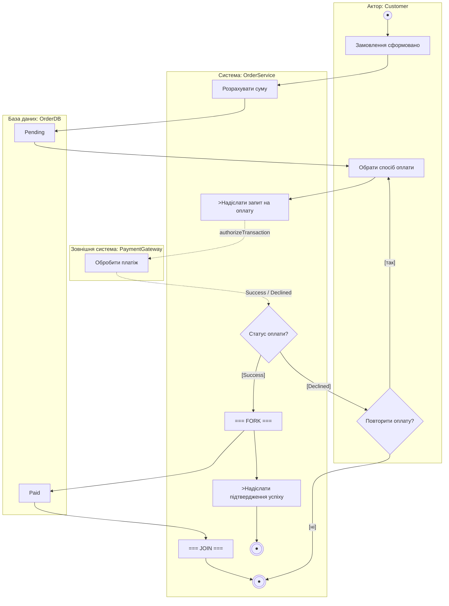

# Prompts and Generations (Lab 4)

## 1: Перша генерація Activity-діаграми бізнес-процесу оплати

### Промпт 1 (на основі файлу spec.md)

> На основі файлу `spec.md` побудуй єдину Activity-діаграму у форматі Mermaid (`flowchart TD` зі swimlanes) для бізнес-процесу оформлення та оплати замовлення (`Checkout Order` + `Calculate Total` + `Process Payment`). Покажи початок і кінець, розгалуження, цикл повторної спроби оплати, паралельну гілку (`fork`/`join`) та обмін повідомленнями з `PaymentGateway`.

### Відповідь ШІ (Версія 1)

