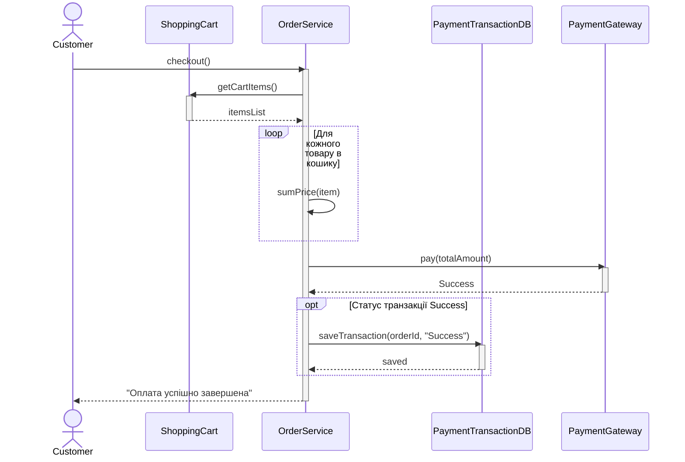
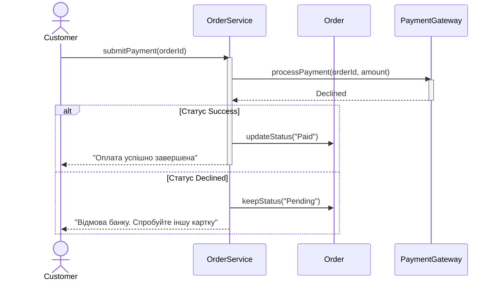
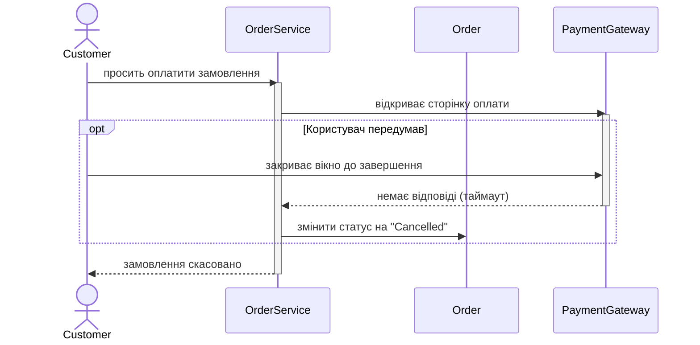

# Prompts and Generations (Lab 3)

## 1: Сценарій 1 — Успішна обробка платежу

### Промпт 1 (на основі файлу spec.md)

> На основі файлу `spec.md` побудуй детальну Sequence-діаграму у форматі Mermaid (`sequenceDiagram`) для Сценарію 1 (Успішна обробка платежу). Покажи взаємодію між учасниками для розрахунку суми замовлення та проведення оплати через платіжний шлюз. Обов'язково використай комбінований фрагмент (`loop` або `opt`) та блоки активації (`activate`/`deactivate`).

### Відповідь ШІ (Версія 1)

## 2: Сценарій 2 (Відмова банку) та Сценарій 3 (Переривання оплати / Таймаут)

### Промпт 2 (на основі файлу spec.md)

> Згенеруй окремі Sequence-діаграми у форматі Mermaid (`sequenceDiagram`) для Сценарію 2 (Неуспішна обробка платежу — статус `Declined`) та Сценарію 3 (Переривання оплати користувачем / Таймаут). У кожній діаграмі використай фрагмент `alt` або `opt` та лінії активації.

### Відповідь ШІ (Версія 1)

**Сценарій 2: Відмова банку**

**Сценарій 3: Переривання оплати користувачем (Таймаут)**

## 3: Аудит та уточнювальний промпт після оновлення spec.md

### Фідбек до ШІ та Промпт 3 (на основі оновленого spec.md)

> У попередніх генераціях виявлено 3 критичні помилки проти `spec.md`, ER-моделі Лаб 1 та Gherkin-сценаріїв Лаб 2:
> 1. У Сценарії 1 ти вигадав учасників `ShoppingCart` та `PaymentTransactionDB`, яких немає в ER-моделі Лаб 1. Використовуй лише `Customer`, `OrderService`, `Product`, `Order` та `PaymentGateway`.
> 2. У Сценарії 2 ти викликав `deactivate OrderService` всередині першої гілки блоку `alt`, через що лінія життя обірвалася до завершення умовного фрагмента. Винеси `deactivate OrderService` після `end`.
> 3. У Сценарії 3 ти використав побутовий текст замість викликів методів і встановив статус `"Cancelled"`, хоча за Gherkin-сценарієм із Лаб 2 та `REQ-3` при перериванні оплати або таймауті (`3.0 с`, `NFR-3`) статус `Order.status` має залишатися `"Pending"`.
>
> Перегенеруй усі 3 Sequence-діаграми для файлу `interactions.md` строго за оновленим `spec.md`.
