# Prompts and Generations (Lab 5)

## 1: Перша генерація UML Component Diagram (Варіант A)

### Промпт 1 (на основі файлу spec.md)

> На основі файлу `spec.md` побудуй UML Component Diagram у синтаксисі Mermaid для інтернет-магазину `Online Store System` у стилі горизонтальних шарів. Покажи всі внутрішні шари (UI, API, Services, Data access, DB), зовнішні інтеграції, інтерфейси та залежності між компонентами.

### Відповідь ШІ (Версія 1)

```mermaid
flowchart TB
    Customer((Customer))

    subgraph System ["Online Store System (Межа системи)"]
        direction TB

        subgraph Presentation ["Presentation"]
            CatalogPage["Catalog Page"]
            CheckoutPage["Checkout Page"]
        end

        I_REST(("REST /api"))

        subgraph API ["API (controllers)"]
            AuthMW["AuthMiddleware"]
            CatalogC["CatalogController"]
            OrderC["OrderController"]
            WebhookC["PaymentWebhookController"]
        end

        I_OrderSvc(("IOrderService"))

        subgraph Services ["Services"]
            CustomerS["CustomerService"]
            CatalogS["CatalogService"]
            OrderS["OrderService"]
        end

        I_OrderRepo(("IOrderRepository"))

        subgraph DAL ["Data access"]
            CustomerR["CustomerRepository"]
            CategoryR["CategoryRepository"]
            ProductR["ProductRepository"]
            OrderR["OrderRepository"]
            CartR["CartRepository"]
        end

        subgraph ExtInside ["Платіжний шлюз"]
            PaymentGateway["PaymentGateway"]
            PaymentPage["Payment Page"]
        end

        StoreDB[("Store DB")]
    end

    EmailProvider["«external» Email / SMS Provider"]
    I_Wh(("Payment Webhook"))

    Customer --> CatalogPage
    Customer --> CheckoutPage
    Customer --> PaymentPage

    CatalogPage --> I_REST
    CheckoutPage --> I_REST
    CatalogC --- I_REST
    OrderC --- I_REST

    OrderC --> I_OrderSvc
    OrderS --- I_OrderSvc

    OrderS --> I_OrderRepo
    OrderR --- I_OrderRepo
    OrderR -. "upward check" .-> OrderS

    OrderS -.-> CartR
    OrderS -.-> EmailProvider

    PaymentGateway --- I_Wh
    WebhookC --> I_Wh

    CustomerR -.-> StoreDB
    CategoryR -.-> StoreDB
    ProductR -.-> StoreDB
    OrderR -.-> StoreDB
```

