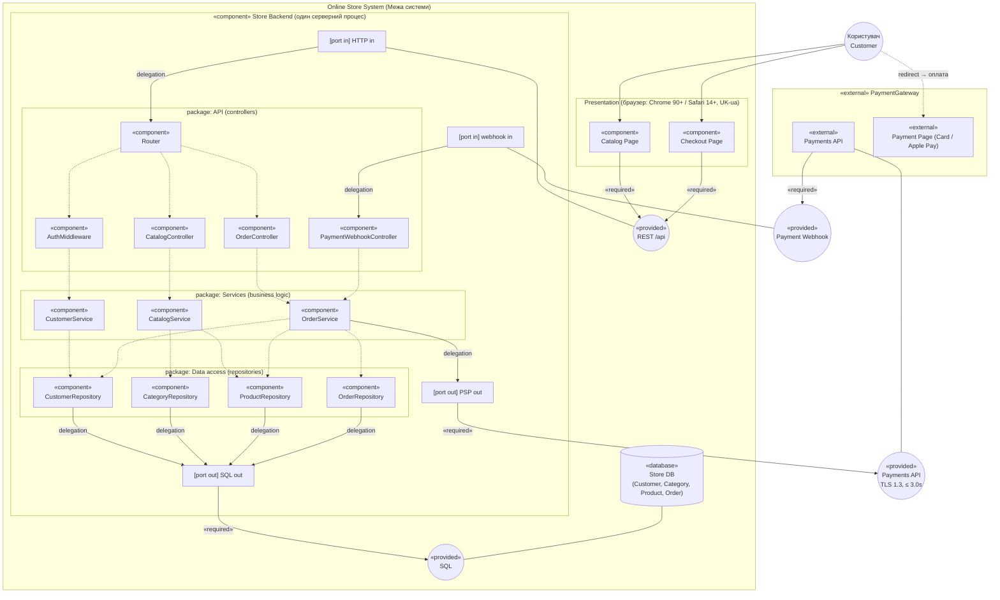

# Architecture — UML Component Diagram (Lab 5)

Обраний підхід декомпозиції: **Варіант A (горизонтальні шари)** (`Presentation → API → Services → Data access → Store DB`).  
Додатково створено інтерактивну HTML-діаграму зі справжніми UML 2.5 портами та `lollipop`/`socket`: [`architecture.html`](architecture.html).

---

## 1. Діаграма компонентів (`Online Store System`)

---

## 2. Аудит трасування до попередніх моделей (Лаб 1–4)

| Компонент / Шар | Дані (Лаб 1: ER) | Вимоги та UC (Лаб 2) | Взаємодія (Лаб 3: Sequence) | Процес (Лаб 4: Activity) |
| :--- | :--- | :--- | :--- | :--- |
| **`Catalog Page`, `Checkout Page`** | Оперують `Category`, `Product`, `Order` | `Customer`, Chrome 90+ / Safari 14+ (`NFR-1`), `UK-ua` (`NFR-5`), `UC_Checkout` | Ініціюють `checkoutOrder()`, `submitPayment()`, `initiatePaymentSession()` | Доріжка `Customer`: ініціація оформлення, вибір способу оплати, перегляд результату |
| **`Router`, `AuthMiddleware`** | Валідує приналежність `Customer` (`UUID id`) | Заборона `Guest` (`Out of Scope` Лаб 2), пікове навантаження `500 RPS` (`NFR-2`) | Точка входу запитів `Customer → OrderService` | Розподіл HTTP-запитів із браузера у контролери |
| **`CatalogController` / `CatalogService`** | `Category`, `Product` (`name`, `price`, `category_id`) | Каталог товарів магазину (`README.md`) | Джерело даних про товари для замовлення | Підготовка переліку `Product` перед оформленням |
| **`OrderController`, `PaymentWebhookController`, `OrderService`** | `Order` (`status`), `Product` (`price`), `Customer` (`customer_id`) | `REQ-1` (`Calculate Total`), `REQ-2` (`Process Payment`), `REQ-3` (`Pending`), `REQ-4` (`Paid`) | Повний цикл `OrderService`: `calculateTotal()`, `authorizeTransaction()`, прийом `PaymentWebhook` | Доріжка `OrderService`: розрахунок, `FORK`/`JOIN`, утримання `Pending` чи перехід у `Paid` |
| **`Customer/Category/Product/OrderRepository` + `Store DB`** | 4 таблиці спільної схеми: `Customer`, `Category`, `Product`, `Order` | Без збереження карток і транзакцій на боці магазину | `getOrderById()`, `findProductsByOrderId()`, `updateOrderStatus()` | Вузли даних `Product` і `Order` (БД не є окремим лейном процесу) |
| **`PaymentGateway` (`<<external>>`)** | Поза межею БД магазину | Зовнішній актор `PaymentGateway` (`ADR-002`), `TLS 1.3` (`NFR-4`), `≤ 3.0 с` (`NFR-3`), `Card` / `Apple Pay` | Учасник `PaymentGateway`: `authorizeTransaction()`, `createPaymentSession()`, `cancelPaymentSession()` | Доріжка `PaymentGateway`: платіжна сесія `3.0 с`, транзакція, повернення результату або таймаут |

---

## 3. Специфікація портів і контрактів (`provided` / `required`)

| Контракт / Порт | Напрям на межі | Постачальник (`provided`) | Споживач (`required`) | Призначення |
| :--- | :--- | :--- | :--- | :--- |
| **`REST /api` (`HTTP in`)** | Вхідний (`Store Backend`) | `Store Backend` (`Router`) | `Catalog Page`, `Checkout Page` | Єдиний HTTP-контракт UI → backend; `HTTP in` делегує виключно в `Router`. |
| **`Payment Webhook` (`webhook in`)** | Вхідний (`Store Backend`) | `Store Backend` (`PaymentWebhookController`) | `PaymentGateway` (`Payments API`) | Асинхронне сповіщення результату транзакції (`Success` / `Declined` / `Timeout`) у `OrderService`. |
| **`Payments API` (`PSP out`)** | Вихідний (`Store Backend`) | `PaymentGateway` | `Store Backend` (`OrderService`) | Авторизація платежу й створення платіжної сесії по `TLS 1.3` із таймаутом `≤ 3.0 с`. |
| **`SQL` (`SQL out`)** | Вихідний (`Store Backend`) | `Store DB` | Репозиторії `Data access` | Запити до спільної схеми (`Customer`, `Category`, `Product`, `Order`). |
