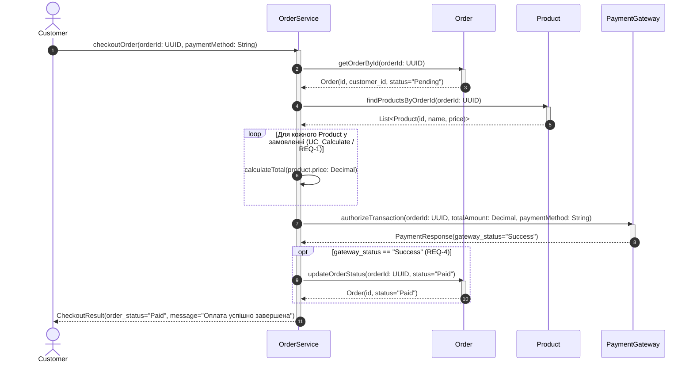
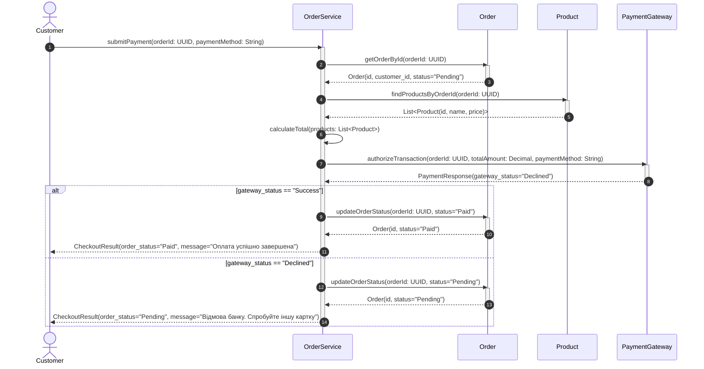
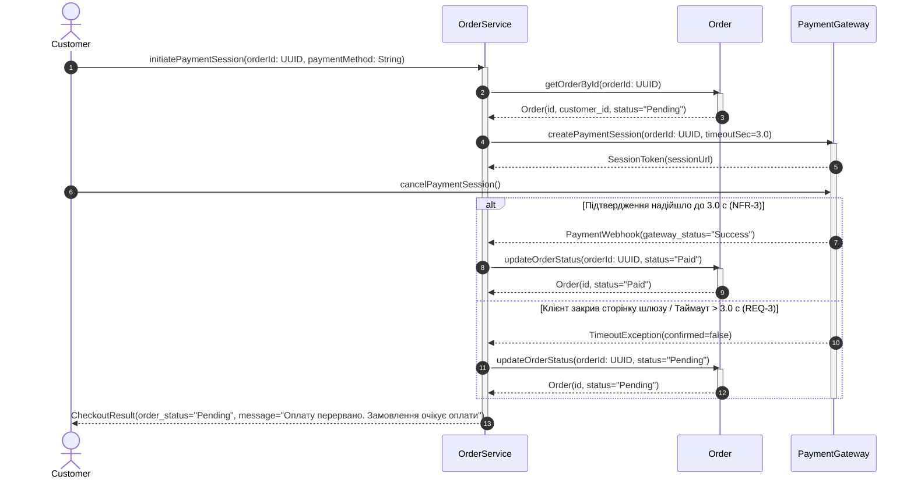

# Interaction Models — Sequence Diagrams (Lab 3)

Обраний прецедент із Лаб 2: **`Process Payment`** (розширює **`Checkout Order`** через `<<extend>>` та спирається на розрахунок вартості **`Calculate Total`** через `<<include>>`).

---

## 1. Сценарій 1: Успішна обробка платежу (`Success -> Paid`)

**Відповідність Лаб 2 (Gherkin + EARS):**
- Розрахунок загальної суми замовлення (`Order`) на основі ціни (`Product.price`) обраних товарів (`REQ-1`, `UC_Calculate`).
- Утримання `Order.status = "Pending"` під час обробки транзакції (`REQ-3`) та відправка запиту до `PaymentGateway` (`REQ-2`, `UC_Payment`).
- При отриманні `gateway_status = "Success"` зміна статусу замовлення на `"Paid"` (`REQ-4`) і повернення клієнту повідомлення `"Оплата успішно завершена"`.

---

## 2. Сценарій 2: Неуспішна обробка платежу / Відмова банку (`Declined -> Pending`)

**Відповідність Лаб 2 (Gherkin + EARS):**
- Відправка запиту на оплату (`Pay by Card` / `Pay by Apple Pay`) до `PaymentGateway` (`REQ-2`).
- Обробка розгалуження за відповіддю шлюзу у фрагменті `alt`: при `gateway_status = "Declined"` статус `Order.status` залишається `"Pending"` (`REQ-3`), а клієнту повертається повідомлення `"Відмова банку. Спробуйте іншу картку"`.
- Лінія активації `OrderService` починається до блоку `alt` і завершується після `end`.

---

## 3. Сценарій 3: Переривання оплати користувачем / Таймаут (`Timeout -> Pending`)

**Відповідність Лаб 2 (Gherkin + EARS + NFR):**
- Поки транзакція обробляється, `Order.status` утримується як `"Pending"` (`REQ-3`).
- Коли `Customer` закриває сторінку платіжного шлюзу до завершення операції, `PaymentGateway` не надсилає підтвердження транзакції (спрацьовує верхня межа очікування `3.0 с` згідно з `NFR-3`).
- Статус `Order.status` залишається `"Pending"`.

