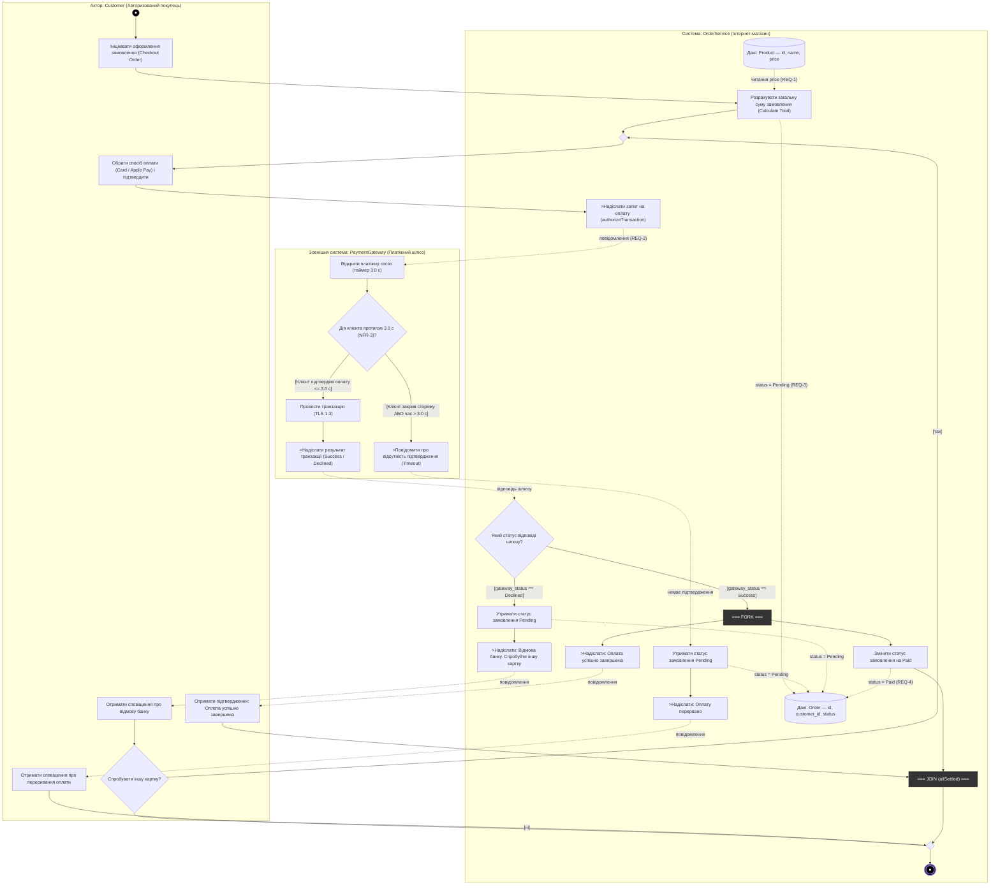

# Process Model — Activity Diagram (Lab 4)

Обраний прецедент із Лаб 2: **`Checkout Order`** (`<<include>>` **`Calculate Total`**, `<<extend>>` **`Process Payment`**). Усі 3 Gherkin-сценарії (`Success`, `Declined`, `Timeout`) та повідомлення із Sequence-діаграм Лаб 3 об'єднано в єдину Activity-діаграму.

---

## 1. Activity-діаграма процесу оформлення та оплати замовлення

---

## 2. Аудит шляхів (Gherkin Лаб 2 → Шлях на діаграмі)

1. **Сценарій 1 (Успішна обробка платежу, `Success -> Paid`):**
   `Start` → `Ініціювати оформлення` → `Розрахувати загальну суму (Product.price)` → `Обрати спосіб оплати` → `Надіслати запит на оплату` → `Відкрити платіжну сесію` → `[Клієнт підтвердив оплату <= 3.0 с]` → `Провести транзакцію` → `[gateway_status == Success]` → `FORK` (`Змінити статус Order на Paid` ∥ `Надіслати: Оплата успішно завершена` → `Отримати підтвердження`) → `JOIN` → `End`.
2. **Сценарій 2 (Відмова банку, `Declined -> Pending`):**
   `Start` → ... → `[Клієнт підтвердив оплату <= 3.0 с]` → `Провести транзакцію` → `[gateway_status == Declined]` → `Утримати статус замовлення Pending` → `Надіслати: Відмова банку. Спробуйте іншу картку` → `Отримати сповіщення про відмову банку` → `Спробувати іншу картку?` → `[так]` повернення через `M_Retry` на повторну оплату або `[ні]` → `End`.
3. **Сценарій 3 (Переривання оплати / Таймаут `3.0 с`):**
   `Start` → ... → `Відкрити платіжну сесію (таймер 3.0 с)` → `[Клієнт закрив сторінку АБО час > 3.0 с]` → `Повідомити про відсутність підтвердження (Timeout)` → `Утримати статус замовлення Pending` → `Надіслати: Оплату перервано` → `Отримати сповіщення про переривання оплати` → `End`.

---

## 3. Аудит повідомлень (Process ↔ Sequence Лаб 3)

| Повідомлення в процесі | Відправник | Отримувач | Відповідність Sequence (Лаб 3) | Реакція на відповідь або її відсутність |
| :--- | :--- | :--- | :--- | :--- |
| Запит на оплату | `OrderService` | `PaymentGateway` | `authorizeTransaction()` / `createPaymentSession()` | Шлюз відкриває сесію з лімітом `3.0 с` (`NFR-3`); за відсутності підтвердження породжується таймаут (`Order.status = "Pending"`). |
| Результат транзакції | `PaymentGateway` | `OrderService` | `PaymentResponse(Success / Declined)` / `TimeoutException` | `OrderService` розгалужує потік через `D_Status` (`Paid` або повтор/очікування `Pending`). |
| Фінальне сповіщення клієнту | `OrderService` | `Customer` | `CheckoutResult(order_status, message)` | `Customer` отримує підтвердження успіху, пропозицію змінити картку або статус переривання. |
