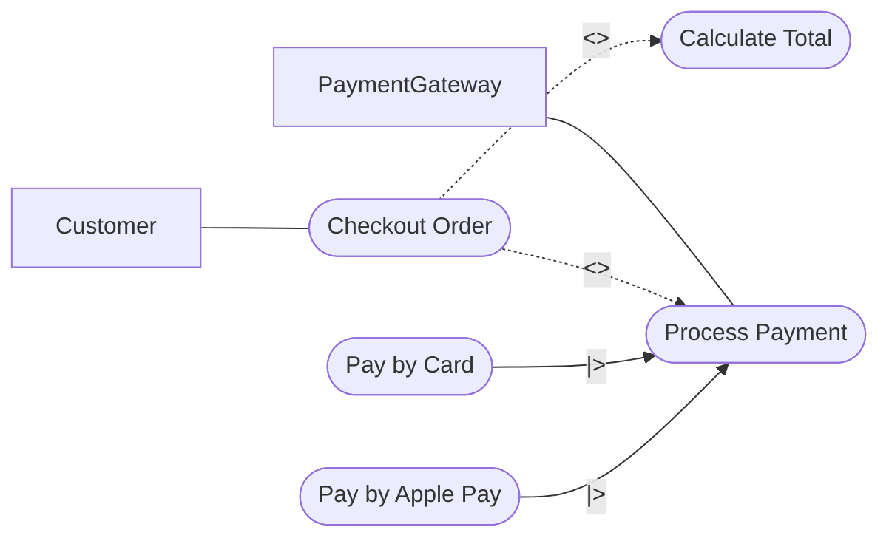

# Functional Requirements and Scenarios (lab 2)

## 1. EARS-вимоги

- **REQ-1 (Ubiquitous):** Система ПОВИННА розраховувати загальну суму замовлення (Order) на основі ціни (price) обраних товарів (Product).
- **REQ-2 (Event-driven):** КОЛИ користувач натискає кнопку "Оплатити", система ПОВИННА відправити запит до PaymentGateway.
- **REQ-3 (State-driven):** ПОКИ транзакція обробляється, система ПОВИННА утримувати статус замовлення (Order.status) як "Pending".
- **REQ-4 (Optional):** ДЕ оплата пройшла успішно, система ПОВИННА змінити статус замовлення на "Paid".

## 2. NFR

1. **Аудиторія та платформи:** Системою користуються авторизовані покупці (Customer) з браузерів Chrome 90+ та Safari 14+.
2. **Навантаження:** Система ПОВИННА стабільно обробляти пікове навантаження до 500 одночасних запитів (RPS).
3. **Продуктивність (Час відгуку):** Час очікування відповіді від PaymentGateway НЕ ПОВИНЕН перевищувати 3.0 секунди.
4. **Безпека:** Обмін даними з платіжним шлюзом ПОВИНЕН шифруватися за протоколом TLS 1.3.
5. **Локалізація:** Інтерфейс процесу Checkout ПОВИНЕН відображатися українською мовою (UK-ua).

## 3. User Story + Gherkin

```gherkin
# language: uk
@payment
Функціонал: Обробка оплати замовлення
  Як Customer (авторизований покупець)
  Я хочу безпечно сплатити своє замовлення через платіжний шлюз
  Щоб моє замовлення перейшло в обробку і статус змінився на Paid

  Передумова:
    Припустимо Customer сформував замовлення (Order) і перейшов до оплати

  Структура сценарію: Успішна або неуспішна обробка платежу
    Коли PaymentGateway повертає статус транзакції <gateway_status>
    Тоді система встановлює статус Order як <order_status>
    І відправляє клієнту повідомлення <message>

  Приклади:
    | gateway_status | order_status | message                               |
    | Success        | Paid         | "Оплата успішно завершена"            |
    | Declined       | Pending      | "Відмова банку. Спробуйте іншу картку"|

  Сценарій: Переривання оплати користувачем (Таймаут)
    Коли Customer закриває сторінку платіжного шлюзу до завершення
    Тоді PaymentGateway не надсилає підтвердження
    І статус Order залишається "Pending"
```

## 4. Use Case Діаграма



## 4: Traceability Matrix

| ID Вимоги | Тип EARS     | Покриття Gherkin                  | Покриття Use Case         |
| :-------- | :----------- | :-------------------------------- | :------------------------ |
| **REQ-1** | Ubiquitous   | -                                 | UC_Calculate, UC_Checkout |
| **REQ-2** | Event-driven | Структура сценарію (всі)          | UC_Payment                |
| **REQ-3** | State-driven | -                                 | -                         |
| **REQ-4** | Optional     | Сценарій: Успішна обробка платежу | UC_Payment, UC_Checkout   |

(Примітка: REQ-3 навмисно залишено непокритою згідно з ТЗ; NFR не додаються в матрицю).
